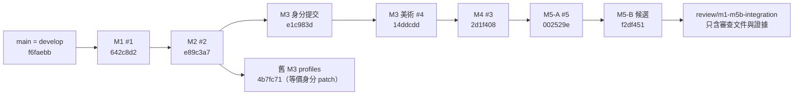

# LR-Anime M1～M5-B 首次整合驗收

審查日期：2026-11-18（Asia/Taipei）。候選 `f2df451b0fccf4c62ac71821817bf130376d18bc`，以最新遠端 M5-B 為準。審查成果位於獨立 `review/m1-m5b-integration`；不改遊戲核心、不合併 PR、不改 Base、不動 develop／main、不部署、不刪分支。

## 結論

**完整六階段整合暫不放行（NO-GO）。候選功能回歸已通過，但尚未達到正式整合的全部流程條件：** M5-B 尚無 PR；儲存庫 merge commit 設定、分支保護、必要 checks／review 放行狀態仍需擁有者確認。沒有發現本輪覆蓋範圍內的程式阻擋缺陷。補齊流程條件後仍須由使用者批准，每次合併後重新測試，不能以本輪候選結果替代中間階段檢查。

## 完整分支依賴圖

箭頭表示 Git 祖先，舊 profiles 提交與 e1c983d 為 patch 等價但 SHA 不同；它不應額外合入，避免重複。證據為 `m3-alternate-range-diff.txt`。沒有刪除該分支。

## 遠端分支 SHA

| 分支 | 完整 SHA |
| --- | --- |
| `main` | `f6faebbb8096967854bacf0708b196ffac2712b9` |
| `develop` | `f6faebbb8096967854bacf0708b196ffac2712b9` |
| `feature/save-protection-v5` | `642c8d2fb1c6faddcfdd1b10e0c69d7231c53eec` |
| `feature/m2-zh-tw-anime-ui` | `e89c3a7ffd3b4131a8be76ca28e5a864edee6fda` |
| `feature/m3-anime-art-integration` | `14ddcddf0a6037e611a70a3a9bf34097d7a7a68f` |
| `feature/m4-survivor-progression` | `2d1f4084b2d422b55cc9879fcf92b870a34a381f` |
| `feature/m5a-survival-needs` | `002529e38d072f39f9af137b14de5206fee5d672` |
| `feature/m5b-survivor-autonomy` | `f2df451b0fccf4c62ac71821817bf130376d18bc` |
| `feature/m3-survivor-profiles` | `4b7fc712bc74cac668069cce71244ab35ce38ee6` |

## PR 最新狀態

API 回傳 Forbidden，改以公開 GitHub PR 頁面內嵌結構化資料核對 state、base/head 與 SHA，再與 `refs/pull/N/head` 比對。不是只採用使用者提供的舊清單。PR reviews／required checks／可合併狀態不據此推定。

| PR | 階段 | 最新狀態 | Base | Head | 單階段提交／檔案數 |
| --- | --- | --- | --- | --- | --- |
| [#1](https://github.com/mini1060919-code/LR-Anime/pull/1) | M1 | OPEN，未合併 | `develop` | `feature/save-protection-v5` | 2／10 |
| [#2](https://github.com/mini1060919-code/LR-Anime/pull/2) | M2 | OPEN，未合併 | `feature/save-protection-v5` | `feature/m2-zh-tw-anime-ui` | 1／22 |
| [#4](https://github.com/mini1060919-code/LR-Anime/pull/4) | M3 | OPEN，未合併 | `feature/m2-zh-tw-anime-ui` | `feature/m3-anime-art-integration` | 2／80 |
| [#3](https://github.com/mini1060919-code/LR-Anime/pull/3) | M4 | OPEN，未合併 | `feature/m3-anime-art-integration` | `feature/m4-survivor-progression` | 1／32 |
| [#5](https://github.com/mini1060919-code/LR-Anime/pull/5) | M5-A | OPEN，未合併 | `feature/m4-survivor-progression` | `feature/m5a-survival-needs` | 1／27 |
| 尚無 | M5-B | 公開 head 搜尋無結果 | 建議先以 M5-A 為 Base | `feature/m5b-survivor-autonomy` | 1／31 |

M5-B 後續 PR 可由[此比較連結](https://github.com/mini1060919-code/LR-Anime/compare/feature/m5a-survival-needs...feature/m5b-survivor-autonomy?expand=1)建立，PR 內容已在 `docs/M5B-PR.md`；本輪不建立或合併。

每段前階段都是後階段祖先，未發現互相分岔或後階段漏掉前階段提交。六個 merge-tree 試算 exit 0，輸出樹等於該階段 Head；這不是對未來 develop 變動的保證。單階段 patch／stat、完整 SHA、PR 資料及歷史圖均保存在 evidence/。

## 審查範圍與差異

M1 增加安全存檔；M2 增加語系／主題與角色面板；M3 增加角色身分、v6 及提供的素材；M4 正式工作／經驗與有上限能力效果；M5-A 加入需求；M5-B 加入有限自主排程。後續階段修改早期 persistence、characterpanel、工作模組屬功能整合，不是把較新版還原為舊版。

`src/core`、`src/world`、建築定義／placement、phase-controller、waves、LICENSE、package-lock 相對 develop 無差異。Three.js 地圖與攝影機未重寫；MIT 原授權保留。戰鬥模組有 M4 預期的有限能力倍率與有效傷害 XP 結算，不能宣稱所有戰鬥程式完全未變；能力效果關閉時原計算一致有單元測試。M5-A 的戰鬥活動疲勞記錄透過工作模組接入。

沒有發現需要額外合入的獨立 profiles 功能；沒有刪除歷史遊戲功能的獨立證據。以上以分段 diff 與測試覆蓋為限，不將它描述成所有玩家存檔或所有遊玩情境的數學保證。

## 本輪真實測試輸出

- npm ci 首次失敗：預設 `/home/agent/.npm/_cacache` 不可寫，exit 254。完整錯誤保留在 npm-ci.log。
- `npm_config_cache=/workspace/.npm-cache npm ci`：成功，added 69 packages in 4s，exit 0；不改鎖檔。
- `npm test -- --reporter=verbose`：30 測試檔、701 項通過，exit 0；10.60 秒，包含逐項案例輸出。
- `npm run build`：成功，exit 0；82 modules、主 JS 842.75 kB／gzip 234.24 kB，CSS 26.07 kB；既有 >500 kB chunk 警告仍在。
- PNG 驗證：32 張精確 RGBA 圖、四人映射／20 表情；28 張可用肖像、18 預留槽回退。
- Playwright：本輪完整 **16／16 通過（50.2 分鐘），exit 0，零失敗、零跳過、零重試**。包含自然日夜、實際瀏覽器 quota、跨版本 JSON、桌面／手機全部案例，沒有以歷史測試取代。

瀏覽器使用 Chromium／SwiftShader、單 worker、deviceScaleFactor 0.5、E2E_SLOW_WEBGL=1，外部設定為 `/workspace/.cloud-setup/LR-Anime/playwright.config.mjs`。新 context 只使用合成存檔；測試產生的歷史截圖已全部恢復，只有本輪代表畫面另存於 evidence/screenshots，避免混入候選差異。

### 長期與基礎效能

本輪單元真實輸出包含：備份 200 黎明 3435 ms；需求 200 週期 1791 ms；自主 30,000 秒（200 週期等值）2272 ms。這些時間有平行單元測試影響，且模型測試不是 200 次完整 3D 夜襲。

另量測派工空缺重排，50 次暖機＋500 樣本：8／32／128 人 p95 約 0.52／1.23／3.15 ms，128 人 max 約 10.30 ms；完整原始數值與診斷腳本在 evidence/benchmark.*。只測 CPU 派工，不含渲染、戰鬥、儲存，也未模擬硬體受限手機。

建置及美術靜態檔容量詳 asset-sizes.txt。美術包含非即時使用的表情 sheet，靜態總量不代表首屏下載量。沒有實機 FPS／記憶體洩漏／冷快取網路量測，不能由軟體 WebGL 測試耗時推定正式效能 SLA。

## 問題與放行條件

| ID | 問題／風險 | 分類／後續 |
| --- | --- | --- |
| INT-01 | 首次 npm ci 預設 cache 不可寫 | 已修復執行環境：使用可寫 cache；保留失敗及成功輸出 |
| INT-02 | GitHub API Forbidden | 公開頁面已核對 PR 內容；保護設定／checks／review 未證實，正式合併前須擁有者核對 |
| INT-03 | M5-B 沒有 PR | 建立以 M5-A 為 Base 的 M5-B PR 後才能完成六階段驗收鏈；本次不自動建立或合併 |
| INT-04 | 主 chunk >500 kB、素材總量大 | 已知效能風險，獨立優化與實機量測，不混入本輪候選 |
| INT-05 | 休息使產量／防衛建築在崗人數下降 | 人工觀察平衡；無新增死亡規則，原 HQ 待命防衛保持 |
| INT-06 | 完整瀏覽器回歸 | 已完成：16／16，exit 0；不再是阻擋項 |
| UX-01～03 | 圖示不明顯、選單不能收合、角色貢獻不明 | 獨立 M5-UX 規劃，見 M5-UX-BACKLOG.md，不修改候選 |

存檔風險、永久備份容量、單分頁限制與回復方案見 [SAVE-SAFETY.md](SAVE-SAFETY.md)。逐 PR Base 調整、merge／squash 比較、每次重測與反向回復操作見 [MERGE-RUNBOOK.md](MERGE-RUNBOOK.md)。

[需求對應測試索引](TEST-MATRIX.md)提供本輪逐項日誌行號，可直接核對代表案例。

測試結束前後再次查詢遠端：九個既有分支 SHA、PR #1～#5 的 state／Base／Head 均未變；M5-B head 公開搜尋仍無 PR。見 final-reference-check.json、final-pr-check.json 與帶時間的 PR 審查資料。沒有建立或推送 tag，也沒有變更任何 PR。

本輪畫面：[桌面返工](evidence/screenshots/m5b-work-1000.png)、[手機休息](evidence/screenshots/m5b-rest-390.png)。PNG 使用 DPR 0.5，實際像素為 CSS viewport 尺寸的一半；手機面板捲至狀態區，立繪仍在上方。

## 證據入口

- [分支與提交](evidence/branch-audit.json)、[PR 公開頁面資料](evidence/pr-audit.json)、[M5-B PR 搜尋](evidence/m5b-pr-search.json)
- [合併樹試算](evidence/merge-tree-preflight.json)、[提交圖](evidence/history-graph.txt)、[舊 M3 等價比較](evidence/m3-alternate-range-diff.txt)
- [首次安裝失敗](evidence/npm-ci.log)、[安裝成功](evidence/npm-ci-retry.log)、[單元逐項輸出](evidence/npm-test.log)、[建置輸出](evidence/npm-build.log)、[完整瀏覽器輸出](evidence/playwright.log)
- [效能原始數值](evidence/benchmark.json)、[診斷腳本](evidence/benchmark.mjs)
