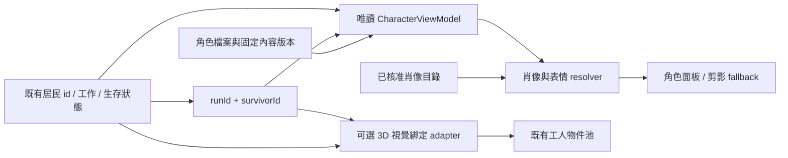

# M3 動漫倖存者系統：需求分析與技術設計

> 歷史設計草案；本次實際完成範圍與差異請見 [M3 實作紀錄](../M3-IMPLEMENTATION.md)。

> 狀態：設計草案，尚未實作。日期：2026-11-17（Asia/Taipei）。本次僅新增文件，不修改遊戲、測試、圖片、存檔或發布設定。

相關文件：[資料與素材契約](02-data-contracts.md)｜[開發拆解、測試與驗收](03-work-plan-and-acceptance.md)

## 1. 核對基準與結論

| 項目 | 本次核對結果 |
| --- | --- |
| M1 PR #1 | `642c8d2fb1c6faddcfdd1b10e0c69d7231c53eec`，`feature/save-protection-v5` |
| M2 PR #2 | `e89c3a7ffd3b4131a8be76ca28e5a864edee6fda`，`feature/m2-zh-tw-anime-ui` |
| main | `f6faebbb8096967854bacf0708b196ffac2712b9` |
| 文件分支 | `docs/m3-survivor-system-design`，從上述 M2 建立；不合併或推送既有 PR |

建議 M3 先完成**穩定角色身分、原創人物檔案、合法素材目錄與安全持久化**。職業及個性先屬於角色設定；能力先呈現、預設不影響模擬。技能加成、成長與自動選才另設平衡驗收關卡，避免一次改動工作、經濟與夜襲。

需要永久保存姓名、人物設定或能力時，建議採用 **v6 外層封裝，保留原有 v4 核心資料**，並繼續讀取 v4/v5。不建議把角色欄位直接塞進現有 v5：舊版可能接受資料卻在重新儲存時丟掉欄位。這是後續開發提案，本次不升級任何實際存檔。

## 2. 現況：資料與行為

| 模組 | 實際結構／行為 | 對 M3 的限制 |
| --- | --- | --- |
| [state.js](../../src/sim/state.js#L111) | 居民僅有 `id, hunger, thirst, buildingId`；`nextSurvivorId` 在記憶體內遞增 | 沒有姓名、職業、個性、角色 HP、經驗、肖像或個人戰鬥單位 |
| [survivors.js](../../src/sim/survivors.js#L91) | `buildingId` 是居民工作連結；建築 `workers[]` 存居民數字 ID；自動指派按建築優先度、類型、建築 ID 排序，再取閒置居民 | 人物設定不得另建一份可衝突的工作名冊；職業不應暗中禁止工作 |
| 同上 | 手動 `assignWorker` 取第一名閒置者；`unassignWorker` 移出最後指派者；停用建築釋放人力 | 現有按鈕不是「指定某個人物」API。若未來加入指定人物指派，必須新增獨立命令並測試，不可讓 UI 直接改陣列 |
| 同上 | 飢餓／口渴上升、消耗補給，達上限死亡；黎明依食物、水、床位與聲望招募 | 立繪表情可反映既有狀態，不能自行補血、招募或復活居民 |
| [economy.js](../../src/sim/economy.js#L32) | 目前主要按工作人數比例、建築等級與全域修正計算產出 | 沒有個人技能修正管線；預設新增人物資料應產生零經濟差異 |
| [combat.js](../../src/zombies/combat.js) | 建築被摧毀可死亡整批工人；庇護所淪陷或人口歸零會結束遊戲；駐軍／民兵是現有群體規則 | 不得把 2D 角色面板誤當新增 3D 戰鬥角色；死亡後需撤除人物選取與綁定 |
| [workers.js](../../src/world/workers.js#L44) | 工人為純視覺物件池，每棟最多 2 人、全局最多 24；夜晚隱藏；按建築與工作人數同步 | 現在**沒有每個 mesh 對應某位居民**；兩個模型 `survivor`、`survivor-knight` 按槽位交替 |
| 同上 | 同步簽章只含 `buildingId:count`；視覺漫步使用 `Math.random()`，暫停時仍可更新 | 同數換人不會重新綁定。視覺亂數、位置、動畫不能拿來決定人物身分或存入權威狀態 |
| [characterpanel.js](../../src/ui/characterpanel.js) | M2 面板透過 `getState` 唯讀顯示居民 ID、工作、飢餓與口渴；開啟暫停，關閉恢復先前暫停狀態 | 可沿用面板架構，新增資料 adapter 與 portrait resolver，不直接寫模擬狀態 |
| [persistence.js](../../src/persistence.js#L329) | v5 外層、v4 payload；明列序列化居民四欄；讀檔重建工作名冊；只保存黎明檢查點 | 角色擴充、識別碼高水位、素材版本都需要明確讀寫／遷移設計；不是加一個欄位就會保存 |

### 本次唯讀／記憶體探查

透過既有匯出函式建立暫存狀態，未存取瀏覽器 localStorage，也未寫檔：

- 居民新增 `characterName` 後，`createSaveData` 不會序列化該欄位。
- v5 外層新增 `characters` 後，經既有還原與序列化流程不會保留它。
- 建立居民 1、2、3，再移除 3：記憶體下一個 ID 是 4；舊存檔還原後，下一名居民卻可重新取得 3。原因是舊檔未保存 `nextSurvivorId`，只能從存活者最大 ID 推算。

因此，**只用居民數字 ID、地圖 seed 或畫面中的第幾個模型當角色身分，都不充分**。

## 3. 角色需求與範圍分期

### M3-A：必要的安全基礎

- 為每個聚落建立 `runId`，每位居民使用 `characterUid = runId + ':' + survivorId`。
- 永久保存居民 ID 高水位；職業、個性、背景、姓名與立繪選擇綁定 UID。
- 預設人物檔案可決定性生成；首次成功保存後，不因重讀或內容目錄更新重新抽選。
- 支援原創固定角色與通用招募角色；職業標籤和現職工作分開呈現。
- 支援替換合法立繪、表情、縮圖；缺檔時顯示 M2 原創剪影，不阻止遊戲啟動。
- v4/v5 只讀檢查與遷移、v6 往返、永久備份、JSON 匯入匯出及手動槽位整體一致性。
- 人物面板仍唯讀；姓名自訂等寫入功能須走驗證命令，於下一黎明保存。若需要立即保存，另設明確的完整檢查點策略，不假裝能保存夜間戰鬥。

### M3-B：3D 身分綁定與互動

在 M3-A 識別碼與生命週期穩定後，才增加視覺 adapter，讓**目前實際顯示的**模型能選到對應人物；仍維持原模型、地圖、漫步與顯示上限。不得承諾所有居民永遠都有可見模型。

### M3-C：另行驗收的能力效果

能力、個性修正及成長先關閉。只有通過經濟及戰鬥平衡測試後才啟用；不與 M3-A 捆綁發布。人物技能不是引入新一套 HP、體力、士氣、好感度、角色戰鬥或抽卡系統的授權。

## 4. 人物設定草案

姓名使用顯示資料，不作主鍵。固定人物設定先保留四名，避免美術需求無限擴張；下列是本專案原創提案，不引用既有動漫人物外觀或背景。

| 角色／內容 ID | 年齡設定 | 職業與個性 | 背景方向 | 能力方向（M3-A 不生效） |
| --- | --- | --- | --- | --- |
| 伊澄凜 `chr_isumi_rin` | 27 | 機械技師；務實、沉著 | 曾維護災區供電設備，希望讓聚落的第一盞燈持續亮著 | 工程、後勤 |
| 朝霧澪 `chr_asagiri_mio` | 25 | 醫護；體貼、堅定 | 曾是撤離站醫護，保存急救手冊並協助新到居民 | 醫療、生存照護 |
| 橘悠真 `chr_tachibana_yuma` | 29 | 斥候；謹慎、好奇 | 熟悉廢棄交通線，整理可用資源與安全路線 | 採集、防衛 |
| 白石紬 `chr_shiraishi_tsumugi` | 24 | 農務員；樂觀、耐心 | 曾照顧社區菜園，從留存種子重建糧食來源 | 農務、後勤 |

固定人物每個 run 最多登場一次；保存已使用的固定原型 ID，不因死亡重新指派同一名故事人物給下一位居民。通用招募人物可共用美術原型，但 UID、姓名與居民身分保持獨立，不能讓共享同一張圖等同同一個人。

職業初版 ID：`generalist, farmer, mechanic, medic, scout, guard, researcher, logistician`。個性 ID：`steadfast, empathetic, pragmatic, curious, reserved, optimistic, patient, cautious`；每人最多兩項、不重複，初版只影響介紹文字及表情風格。

能力採 `agriculture, engineering, medicine, scavenging, defense, logistics` 六項整數等級 0–5。舊存檔遷移的能力預設全 0；面板明確標示「能力效果尚未啟用」。不把職業當工作限制，也不改原有自動指派順序。

未來若驗收 M3-C，可先實驗「相關技能平均每級 +2%、單棟總加成上限 +10%」；僅是待平衡提案，不是本版數值。應排除無工人設施，不改維生消耗、敵人血量、射程或招募門檻；缺人物資料、效果關閉時必須與原版完全相同。

角色生命週期以實際居民集合做 reconcile，不解析 toast 文字。既有事件會被 drain、上限只有 50 筆，建築倒塌也不是每位死者各發一筆事件；僅監聽事件不足以維持身分。建議在讀檔、人口變動後，以及每次序列化前核對 core 與人物表。黎明招募後立刻存檔的順序尤其需要涵蓋，不能等下一幀才補人物。

人物生成使用獨立、決定性的資料亂數，不消耗既有模擬或視覺的 Math.random。原型／圖片不可用時，新招募者使用內建通用原型與剪影，不能因 UI 資源故障改變招募條件；已生成的 runtime record 在重試寫入時不重新抽選。

## 5. 2D 肖像與 3D 居民的對應

資料流只向呈現層輸出：

**M3-A 保持原 renderer 不變**：從人物面板顯示工作建築與居民 ID；點擊目前的 3D 代表物只可解讀為建築的人員入口，不能宣稱該 mesh 就是「伊澄凜」。這一階段可先不新增地圖點擊功能。

**M3-B 的目標契約**：

1. 原有顯示預算不變：每棟最多 2 個、全局最多 24 個，仍優先顯示人數較多的建築。
2. 建築實際 `workers[]` 中以穩定數字 ID 排序取顯示名單；綁定 `survivorId`、`characterUid` 到 mesh root 的 `userData`，不把 mesh 放進存檔。
3. 同步簽章必須包含實際居民 ID，而不只是人數。同數換人、死亡、停用、拆除、讀檔與重啟都重新核對綁定。
4. 回收物件時清除舊 UID、選取狀態與快取；下一次取出重新綁定。Raycast 從子 mesh 找綁定 root，拒絕已死亡或不同 run 的 UID。
5. 未顯示的居民仍可在名冊開啟人物面板，顯示原因：未指派、夜間隱藏、每棟槽位限制或全局預算限制。不能因此把他判為失蹤或死亡。
6. 夜間隱藏只是視覺規則，**不等於停止工作**。不得從立繪表情或 mesh.visible 回寫生產、死亡或防禦狀態。
7. 不更動地圖生成、地形、建築 GLB、相機數學、敵人路徑或 Three.js 渲染架構；綁定是現有顯示層的小範圍擴充。

## 6. 立繪、美術與表情

採原創成年倖存者設定，日系動畫線條與末日生存裝備，統一視線高度、光源、色盤與裁切安全區。各職業以工具、配件及配色區分，不以性別或外貌決定能力。

建議首批只驗證「1 名角色 × neutral／focused／worried」；視覺、授權及效能通過後，再擴充四人。表情以唯讀優先序選取：危險提示（若有可信的暫態事件）＞飢餓／口渴門檻＞工作中 focused＞neutral。死亡者不保留為可指派居民；沒有角色 HP 的現況下不自造「受傷血量」。具體 ID、檔案、尺寸、fallback 及授權規格見資料契約。

**肖像不得加入現有 GLB manifest**。[loader.js](../../src/assets/loader.js#L15) 會把 `assets/manifest.json` 所有類別全部交給 GLTFLoader；把 PNG/WebP 放入其中會造成整個啟動流程失敗。M3 必須另設 UI portrait manifest、延遲載入及失敗 fallback，不阻塞 `assetsPromise`。

## 7. 存檔相容性與風險

| 風險 | 嚴重度 | 建議處理 |
| --- | --- | --- |
| 角色欄位附加在 v5，舊 serializer 忽略它們 | 高 | 永久角色資料使用 v6；完整序列化／還原與往返測試，不能只放寬 validator |
| 最高 ID 居民死亡後讀檔重用 ID | 高 | 保存 `nextSurvivorId` 高水位；run namespace；不要跨 run 以 seed+ID 對應人物 |
| 外部 sidecar 人物 JSON 與主存檔不同步 | 高 | 同一封裝保存核心與人物資料；槽位、匯入、備份也整體處理，不用另一個獨立 localStorage key 當權威資料 |
| 升級前寫入失敗／quota | 高 | 先驗證、重建與估算大小；完整永久備份原始 v4/v5 bytes，再原子替換；任何失敗保留原檔、明確提示 |
| 舊 M1/M2 讀到 v6 | 高 | 舊版應將其視為未知版本並拒絕覆寫；「能讀 v4/v5」不等於「舊版能讀 v6」；降版需顯式匯出 legacy 副本 |
| v5 payload 在還原時套用預設、資源上限、工作名冊重建 | 中高 | 與原版還原結果比較，保留原始備份；不可宣稱原始值與正規化結果逐字相同 |
| legacy 空／缺失居民陣列會補初始人口 | 高 | 舊行為存在，但無法判斷是否應復活。建議列為需復原確認的例外，不自動提交 v6；原始資料可匯出。v6 的明確空人口不得補人 |
| 角色原型、表情或素材被移除 | 中 | 保存邏輯 ID、內容版本與姓名快照；呈現缺檔用剪影，不重抽人物、不刪除檔案 |
| 圖片、歷史人物無限制寫進 localStorage | 高 | 只存輕量參照，不存圖片或 base64，不永久累積每次死亡的完整角色檔；沿用備份輪替與永久釘選 |
| 大型名冊超過既有 2 MiB 上限 | 中高 | 維持上限，拒絕新寫入但保留舊檔；實測 10,000 人邊界，不偷偷截斷人物資料或提高上限 |
| 未來能力版本／未知功能被忽略 | 高 | `requiredFeatures` 與角色 schema 版本明確驗證；不理解必要語義時禁止自動覆寫 |

遷移時只對有效且非歧義的 v4/v5 生成檔案；保持原 ID、工作、研究、建築、資源與夜襲規則。未知版本、重複 UID、人物／居民對應不全、非法數值或實際重建失敗，都停止自動寫入。缺一張肖像不等同存檔損壞，不應阻止遊戲。

## 8. 不變條件與待決策事項

開發期間必須守住：既有工作連結唯一來源、原來的生存／死亡與招募規則、原地圖與夜襲、黎明檢查點語義、永久備份保護、繁中／英文切換不改角色識別碼。

本次建議預設值已足以拆工，不需先取得圖片或新增憑證。後續進入實作前需要確認的產品決策限於：固定四名角色是否採用、是否允許改名、空人口 legacy 的復原互動、M3-C 是否納入後續平衡版本。未決不影響本次設計完成，也不代表已授權啟用能力效果。

本次沒有新增美術、執行正式存檔遷移、重跑產品測試或聲稱 M3 已可玩。原 M2 記錄的 466 項單元與 6 項瀏覽器通過是歷史基準，不是本文件階段的新測試結果。
